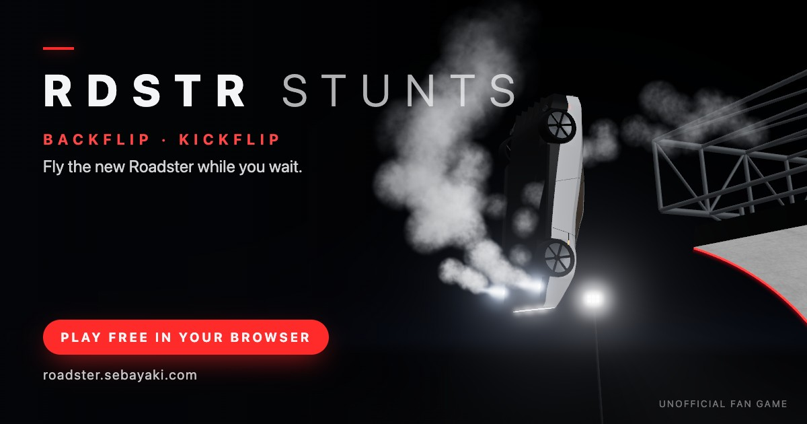

**Play:** [https://roadster.sebayaki.com](https://roadster.sebayaki.com)

# RDSTR Stunts



An unofficial fan game for the wait until the new Roadster ships. Fly the car through the two
stunts from its October 2026 unveil, right in the browser on desktop or phone:

- **BACKFLIP — The Curl.** Build speed down the runway (85–105 km/h), ride a 24 m ramp that
  curls past vertical, leave the lip upside down, keep the rotation going and land it on the
  cold-gas thrusters.
- **KICKFLIP — The Lineup.** Pick your speed (55–85 km/h), thrust off the ground before five
  parked vehicles, barrel-roll a full 360° over them and land soft past the last one.

Landings are graded perfect (×2), great (×1.5) or good on the touchdown angle and impact speed,
and scored on the trick, air time, height and the cold gas you save; doubles are worth more. A
kickflip has to touch down past the lineup, or it is TOO SHORT and scores no trick. Best scores
stay in your browser.

> Fan-made. Not affiliated with or endorsed by Tesla, Inc. Vehicle names are used only to
> describe what the stunts recreate. All models, textures and sounds are generated in code; the
> game uses no Tesla images, logos or assets.

## How to play

| Action                    | Keyboard     | Touch                          | Gamepad            |
| ------------------------- | ------------ | ------------------------------ | ------------------ |
| Gas                       | ↑ / W        | GAS                            | RT                 |
| Brake / reverse           | ↓ / S        | BRAKE                          | LT                 |
| Cold-gas thrusters (hold) | Space        | THRUST                         | A                  |
| Flip / roll in the air    | ← / A, → / D | ↺ ↻                            | Left stick / D-pad |
| Restart                   | R            | ❚❚, then RESTART               | Y                  |
| Pause                     | Esc / P      | ❚❚                             | Start              |
| Camera framing            | C            | —                              | —                  |
| Mute                      | M            | Speaker button or SOUND toggle | —                  |
| Units (km/h ↔ mph)        | U            | KM/H · MPH toggle              | —                  |

- Rotation is screen-relative. In the backflip the camera watches from the side, so ← (↺) flips
  the car backwards; in the kickflip it stays behind the car, so ← rolls it into a kickflip and
  → into a heelflip.
- Hold the rotation until the car is nearly upright, then let go: stabilizing thrusters level
  it. Hold the thrusters to soften the touchdown; the tank lasts only a couple of seconds.
- On the menu, Enter, Space or A plays the focused stunt (the first by default). On the result
  and pause cards they press the focused button (RETRY or RESUME by default), R or Y restarts and
  Esc or B leaves the card.
- On phones and tablets the on-screen controls appear during a run: ↺ ↻ bottom left, GAS, BRAKE
  and THRUST bottom right, pause and mute top right. The sound and units toggles are on the
  menu and the pause card. Landscape shows the most of the scene.
- A gamepad (standard mapping) is picked up after its first button press; the menu's controls
  sheet then shows its buttons.

## How it works

- **Physics** ([`src/physics/`](src/physics)): an arcade model stepped at a fixed 240 Hz and
  fully deterministic, so tests can replay whole runs. On the ground the car moves along the
  level's track profile; the Curl is a curve built from curvature segments, and fan suction holds
  the car on it past vertical, so reaching the lip is a test of momentum. In the air the car
  flies a ballistic arc in the stunt plane with pitch and roll: the thrusters push along its up
  axis at 2.6 g while the cold gas lasts, and the spin input drives the pitch (backflip) or the
  roll (kickflip). Touchdown tests the body corners and tire contacts against the ramp, the
  ground and the lineup's collision outlines and grades the landing; a wreck becomes a 3D
  rigid-body tumble. Every tunable lives in [`src/physics/tuning.ts`](src/physics/tuning.ts).
- **Graphics** ([`src/render/`](src/render)): three.js with ACES tone mapping, bloom and
  reflections from a dim studio environment. The Roadster, the five lineup vehicles, the Curl
  with its truss tower and the night venue are built in code from lofted cross-sections,
  extrusions and instanced parts; surface textures are generated from seeded noise at load, and
  jets, clouds, sparks and smoke are pooled GPU particles. Phones get a low tier: no shadows or
  MSAA, fewer particles, a lower pixel ratio.
- **Sound** ([`src/audio/`](src/audio)): procedural WebAudio. Oscillators make the motor and
  inverter whine, filtered noise makes the road, the wind and the cold-gas hiss and roar, and
  every cue is synthesized. There are no audio files.
- **No backend, no downloads**: the build is a static site that makes no network requests while
  you play. The only bitmaps are the author avatar in the menu footer and the icons and link
  preview in `public/`, which are screenshots of the game's own scenes.

## Project layout

| Path                          | Contents                                                                                                    |
| ----------------------------- | ----------------------------------------------------------------------------------------------------------- |
| `index.html`, `src/main.ts`   | Page shell with the meta and link-preview tags; the entry point that starts the `App`                       |
| `src/app/`                    | Game director: run state machine and frame loop (`app.ts`), event routing, attract demo, debug hooks        |
| `src/core/`                   | Shared types, the Roadster's dimensions (`car-spec.ts`), math, settings and best-score storage              |
| `src/levels/`                 | The two stunts as data: the Curl's profile, the lineup and its collision outlines, speed bands              |
| `src/physics/`                | Car physics, track and collision queries, wreck rigid body, scoring, tunables, autopilot                    |
| `src/render/`                 | Renderer, camera rig, the Curl (`ramp-model.ts`), textures, environment light per material (`env-scale.ts`) |
| `src/render/roadster/`        | The Roadster's body loft, wheels and materials, assembled by `roadster-model.ts`                            |
| `src/render/vehicles/`        | The lineup's vehicles and stage, assembled by `vehicles-model.ts`                                           |
| `src/render/scenery/`         | Venue parts (floodlights, LED lines, grandstand, markings), assembled by `scenery.ts`                       |
| `src/render/fx/`              | Particle system and sprite atlas behind `fx.ts`                                                             |
| `src/audio/`                  | Audio engine and graph, continuous layers, one-shot cues, DSP helpers, offline self-check                   |
| `src/input/`                  | Keyboard, touch and gamepad merged into one control state; bindings in `mapping.ts`                         |
| `src/ui/`                     | DOM HUD: menu, run gauges, result and pause cards, popups, device-aware control names                       |
| `src/tests/`                  | Vitest specs and `sim.ts`, a headless run helper                                                            |
| `dev/`                        | Preview pages on a shared `harness.ts`, including the link-preview and app-icon scenes                      |
| `scripts/`                    | `snap.mjs` (screenshots), `social-assets.mjs` (renders `public/`), `chrome.mjs` (shared launcher)           |
| `public/`                     | Copied as-is into the build: link preview and icons                                                         |
| `.github/workflows/pages.yml` | Checks, builds and deploys to GitHub Pages                                                                  |

## Development

Built with [Vite](https://vite.dev/), TypeScript (strict) and [three.js](https://threejs.org/),
checked with Vitest, ESLint and Prettier. Requires Node.js 22 (22.13+) or 24; CI uses 24.

```bash
npm install
npm run dev        # dev server: the game on http://localhost:5173, previews under /dev/
npm run build      # typecheck + production bundle in dist/
npm run preview    # serve dist/ locally
npm run check      # typecheck + lint + tests, as CI runs before every deploy
npm test           # the tests only
npm run typecheck
npm run lint
npm run format     # Prettier on the whole repo
npm run snap -- "<url>" snaps/<name>.png   # headless screenshot, see below
npm run social     # re-render the link preview and icons, see below
```

### URL switches

| Param                       | Effect                                                                 |
| --------------------------- | ---------------------------------------------------------------------- |
| `?level=backflip\|kickflip` | Skip the menu and start that stunt                                     |
| `?autopilot=1\|double`      | The autopilot flies every run (single or double trick); no best scores |
| `?demo=0`                   | No attract demo behind the menu                                        |
| `?quality=low\|high`        | Force a render tier (default: low on phones)                           |
| `?touch=1\|0`               | Force the on-screen touch controls on or off                           |
| `?debug=1`                  | Draw the car's collision box and local axes                            |

### Debug hooks

`window.__game` is always installed, for scripted checks and screenshots:

- `play(id)`: start a run of `"backflip"` or `"kickflip"`, like PLAY.
- `advance(seconds, driver?)`: step the whole game in fixed 1/60 s frames, then render once.
  Real-time play stays frozen afterwards, so a screenshot shows exactly that frame. `driver` is
  `"autopilot"` or fixed controls `{ throttle, brake, thrust, spin }`.
- `state()`: a JSON summary (run state, level, demo, camera, landing or crash, best scores,
  settings). `car()`: a copy of the car snapshot being rendered. `level()`: the level definition.
- `realtime(on)`: resume (`true`) or freeze (`false`) real-time play.
- `pose(fields)`: render the car with these snapshot fields instead of the physics state; `null`
  hands it back to physics.

`window.__snapReady` turns true once the first frames are drawn, in the game and on every dev
page.

### Dev preview pages

With `npm run dev` running, each part of the game has a preview page. The 3D pages share
[`dev/harness.ts`](dev/harness.ts): the game's renderer with orbit controls, plus `?view=<preset>`,
`?t=<s>` (advance time before the first frame), `?freeze=1` (stop time after it, for stable
screenshots) and `?quality=low`. `window.__harness` exposes `scene`, `camera`, `renderer`,
`setView(name)` and `step(seconds)`.

- `/dev/roadster.html`: the Roadster in a dark studio; logs draw calls and triangles.
  `view=hero|side|profile|front34|rear34|press34|pressrear|front|rear|top|under|wheel|chase`,
  `thrust=1`, `spin=1`, `brake=1`, `susp=-1..1`, `lights=0`, `view=custom&cam=x,y,z,tx,ty,tz,fov`.
- `/dev/vehicles.html`: the lineup on a stand-in venue; logs triangles, draw calls and the fit to
  the collision outlines. `view=front|three-quarter|side|top|chase`,
  `solo=model3|modelY|semi|cybertruck|cybercab` (with
  `view=three-quarter|front|nose|side|rear|rear-three-quarter|top`), `clay=1` for gray materials.
- `/dev/scenery.html`: either venue with car-sized boxes for scale. `level=backflip|kickflip`,
  `view=overview|ramp-side|ramp-base|runway-chase|aerial|lineup-front|lineup-chase|game-side|game-chase`,
  `view=custom&pos=x,y,z&look=x,y,z&fov=deg`, `focus=spawn|second|x,y,z`, `stats=1` to log the
  draw calls, triangles and lights.
- `/dev/fx.html`: jets, ground clouds, sparks and smoke on a scripted Roadster.
  `demo=hover|fly|crash|burnout`, `scenery=backflip|kickflip` for the real venue,
  `view=side|front|close|ground|wide|chase|curl|lineup`.
- `/dev/hud.html`: every HUD screen with fake data and working input.
  `screen=menu|ready|run|ramp|air|result|crash|short|pause|popup`, `level=backflip|kickflip`,
  `units=imperial`, `muted=1`, `touch=1`, `reason=angle|impact|obstacle`, `popup=0..3`, `bg=css`
  for a CSS backdrop instead of the 3D venue.
- `/dev/audio.html` (no harness): every cue, the engine layers on sliders and a live meter.
  `selfcheck=1` renders every cue, a scripted run and a worst-case mix offline and measures their
  peak and loudness.
- `/dev/og.html` and `/dev/icon.html`: the link-preview (1200 × 630) and app-icon (square)
  scenes. `cam=x,y,z,tx,ty,tz,fov` tries another framing; `og.html?at=<s>` picks the moment to
  freeze.

### Screenshots

`npm run snap -- "<url>" <out.png>` opens the page in headless Chrome, waits for
`window.__snapReady`, runs `--eval`, waits `--wait` ms and saves the shot. Options:
`--size=1280x720`, `--wait=1000`, `--eval="<js>"`, `--timeout=30000`. Console output and page
errors are printed, and a page error exits with code 1. It needs a local Chrome: the macOS app by
default, any other binary through `CHROME_PATH`. Keep shots in `snaps/` (gitignored):

```bash
npm run snap -- "http://localhost:5173/?level=backflip" snaps/air.png \
  --eval="__game.advance(10.6, 'autopilot')"
npm run snap -- "http://localhost:5173/dev/roadster.html?view=rear34&freeze=1" snaps/rear.png
```

## Testing

`npm test` runs the Vitest specs in `src/tests/` in Node, no browser needed:

- `backflip`, `kickflip`: the autopilot lands the single and the double of each stunt, and
  scripted inputs check the speed band, the roll-back when too slow and the ways to wreck (no
  rotation after the lip, no thrust, no lift-off, too low a hop).
- `release`: simulated players with human reaction delays let go of the spin anywhere from 80°
  early to 10° late and still land; half a turn off still wrecks.
- `physics`, `profile`, `determinism`: driving, braking and reverse, thrust and gas, the run
  flow, wrecks, the track shapes, and identical results under jittery frame times.
- `scoring`, `input-mapping`, `storage`, `ui-format`: trick names, grades and points; key and
  gamepad bindings; settings and best scores without localStorage; HUD text and share links.

The tests are what prove both stunts stay landable, so run them after any change to
`src/physics/tuning.ts` or the levels. Rendering and sound are checked by eye and ear on the dev
pages, with `npm run snap` and the audio self-check.

## Social images

`public/og.jpg` (the 1200 × 630 link preview), `apple-touch-icon.png`, `icon-192.png` and
`favicon.ico` are rendered from `/dev/og.html` and `/dev/icon.html`. After changing the car or the
venue, regenerate them while `npm run dev` runs:

```bash
npm run social                                   # against http://localhost:5173
npm run social -- --base=http://localhost:5174   # another dev server
```

X and other apps cache link previews, so a new image can take a while to show up there.

## Deploying

[`.github/workflows/pages.yml`](.github/workflows/pages.yml) runs on every push to `main`:
`npm ci`, `npm run check` and `npm run build`, then it publishes `dist/` to GitHub Pages. One-time
setup for `roadster.sebayaki.com`:

1. Repository **Settings → Pages → Build and deployment → Source: GitHub Actions** (before the
   first push, so the raw sources are never published).
2. DNS: a `CNAME` record `roadster` → `sebayaki.github.io`.
3. **Settings → Pages → Custom domain:** `roadster.sebayaki.com`, then **Enforce HTTPS** once the
   certificate is issued. Actions deployments take the domain from this setting; the `CNAME`
   file in the repository root is not used.

The build uses relative asset paths (`base: "./"`, override with the `VITE_BASE` environment
variable), so it also works from a subpath. The link-preview tags in `index.html` use absolute
`https://roadster.sebayaki.com/` URLs.

## License

[MIT](LICENSE). Made by [sebayaki.eth](https://x.com/0xsebayaki).
